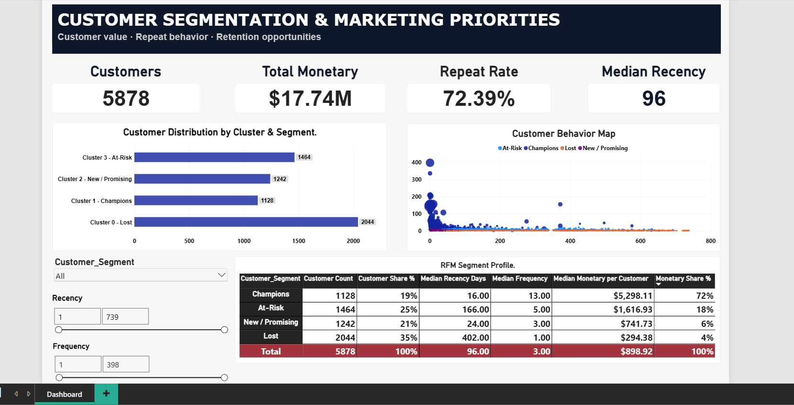

# Day 3 — Customer Segmentation Dashboard & Business Strategy

## Project Overview

This project turns an already-segmented e-commerce customer dataset into a Power BI dashboard and a practical marketing recommendation. The objective is to help a marketing team understand the size and value of each customer segment, identify customers who may need re-engagement, and select suitable campaigns for different customer groups.

The visualization uses the supplied `segmented_customers.csv` file. The segmentation fields were prepared upstream and imported into Power BI; Power BI was then used to build measures, compare segments, and present the findings in a single interactive page.

## Objectives

- Visualize customer segment distribution and cluster membership.
- Compare historical customer monetary value across segments.
- Examine customer recency and frequency patterns.
- Create a concise one-page marketing recommendation based on the segment evidence.
- Complete the deliverables within a four-hour timebox by prioritizing validation, core visuals, and business decisions over unnecessary complexity.

## Tools Used

| Tool | Role in the project |
|---|---|
| **CSV dataset** | Source for the customer-level segmentation results. |
| **Python / pandas** | Supporting data preparation and generation/inspection of the segmented customer output shown in the RFM preview. |
| **Power BI Desktop** | Data import, column configuration, DAX measures, visualizations, slicers, formatting, and dashboard validation. |
| **DAX** | Dynamic measures for customer counts, monetary value, segment shares, repeat-customer rate, and RFM profile summaries. |
| **Markdown / GitHub README** | Project documentation and communication of methodology, results, caveats, and proposed business actions. |

The dashboard was built from the provided CSV rather than requiring the raw transaction file to be reprocessed in Power BI. This reduced the scope and helped keep the work within the time limit.

## Dataset and Structure

**Source file:** `segmented_customers.csv`

The file contains **5,878 rows and 6 columns**, with one row per customer.

| Field | Description |
|---|---|
| `Customer ID` | Customer identifier; should not be summed. |
| `Recency` | Days since the customer's latest recorded purchase; lower values indicate more recent activity. |
| `Frequency` | Number of recorded purchases for the customer. |
| `Monetary` | Historical monetary value attributed to the customer. |
| `Cluster` | Numeric cluster identifier assigned upstream. |
| `Customer_Segment` | Business-readable segment label assigned upstream. |

### Data quality checks

The supplied file was checked before dashboarding:

- **5,878** customer rows.
- **5,878** unique customer IDs.
- **0** duplicate customer IDs.
- **0** duplicate full rows.
- **0** missing values across the six columns.
- `Recency` ranges from **1 to 739 days**.
- `Frequency` ranges from **1 to 398 purchases**.
- `Monetary` ranges from **2.95 to 608,821.65** in the source's monetary units.

The source file represents a customer-level snapshot, not a transaction-level table. It has no individual order dates, marketing-contact history, advertising expenditure, campaign-response outcomes, or profit/cost columns.

## Segmentation Results

Four segments are represented in the CSV:

| Cluster | Customer segment | Customers | Share of customers | Historical monetary value | Share of monetary value |
|---:|---|---:|---:|---:|---:|
| 0 | Lost | 2,044 | 34.77% | 703,266.93 | 3.96% |
| 1 | Champions | 1,128 | 19.19% | 12,844,515.56 | 72.39% |
| 2 | New / Promising | 1,242 | 21.13% | 1,063,388.16 | 5.99% |
| 3 | At-Risk | 1,464 | 24.91% | 3,132,258.53 | 17.65% |
| **Total** |  | **5,878** | **100.00%** | **17,743,429.18** | **100.00%** |

The monetary values are kept in the units supplied in the CSV. Confirm the source currency before displaying a currency symbol in a published report.

### Additional profile statistics

| Segment | Average recency | Median recency | Average frequency | Median frequency | Median monetary value |
|---|---:|---:|---:|---:|---:|
| Champions | 25.51 days | 16 days | 19.89 | 13 | 5,298.11 |
| At-Risk | 213.50 days | 166 days | 5.39 | 5 | 1,616.93 |
| New / Promising | 28.51 days | 24 days | 3.01 | 3 | 741.73 |
| Lost | 394.66 days | 402 days | 1.41 | 1 | 294.38 |

These are descriptive statistics for the supplied labels. The README does not assume that the label alone proves why a customer stopped purchasing.

## How the Project Was Planned and Executed

The work was organized around the Day 3 requirement: **visualize customer segments and formulate a one-page marketing recommendation**.

### Stage 1 — Inspect and validate the segmented data

The CSV was reviewed for row count, column names, data types, unique customer IDs, missing values, duplicates, and plausible ranges. This ensured the visuals would be based on a consistent customer-level table rather than accidental transaction-level duplication.

### Stage 2 — Import and model in Power BI

The CSV was loaded through Power BI's Text/CSV connector. The data types were reviewed: customer ID was treated as an identifier, cluster as a whole number, segment as text, and RFM attributes as numeric values. Because all required fields were already in the same customer-level file, the report used a simple **single-table model**; no relationships or date table were necessary.

The default summarization for `Customer ID` and `Cluster` was set to **Don't summarize**. The dashboard relies on explicit measures for the metrics that need aggregation.

### Stage 3 — Create measures

Measures were created for customer count, total monetary value, customer share, monetary share, repeat customers, observed repeat-customer rate, average recency and average frequency. These measures allow the dashboard to respond to the segment and numeric-range slicers.

### Stage 4 — Build the one-page dashboard

The dashboard uses a dark navy header, a KPI row, two comparison visuals, a customer behavior scatter chart, a segment profile matrix, and slicers. The design prioritizes four questions: how many customers are in each segment, how much historical monetary value each segment represents, how recency and frequency are distributed, and how the segments differ on the key RFM metrics.

### Stage 5 — Interpret results and draft campaign actions

The final stage connects the descriptive findings to proposed marketing campaigns. The recommendations are hypotheses to test, not measured campaign results: the supplied CSV does not record contact cost, campaign assignment, responses, incremental purchases, or margins.

## Power BI Dashboard

The report is a one-page, widescreen dashboard titled **Customer Segmentation & Marketing Priorities**.

### KPI cards

- **Customers:** 5,878
- **Total Monetary:** approximately 17.74 million in the source's monetary units
- **Repeat Rate:** 72.39%
- **Median Recency:** 96 days

The repeat-customer rate is calculated as the share of customer records with `Frequency >= 2`. It is a lifetime/observed-history measure based on the supplied frequency field, not a fixed 30-, 60-, 90-, 180-, or 365-day repeat-purchase rate.

### Visual 1 — Customer Distribution by Cluster & Segment

A horizontal bar chart compares customer counts across the four combined cluster/segment labels. It shows that **Lost** is the largest group with 2,044 customers (34.77%), followed by **At-Risk** with 1,464 customers (24.91%), **New / Promising** with 1,242 (21.13%), and **Champions** with 1,128 (19.19%).

Cluster and segment are shown together because each cluster ID maps to one segment label in this file; separate duplicate charts for cluster and segment would add little value.

### Visual 2 — Customer Behavior Map

A scatter chart compares **Recency** and **Frequency**, with segment used as the legend and Monetary available to convey customer value through bubble size and/or tooltips. Each point should represent an individual customer, using `Customer ID` as the point-level identifier.

The ranges are highly skewed: Frequency reaches 398 and Monetary reaches 608,821.65. The scatter can therefore contain dense areas and outliers. Labels are intentionally avoided to prevent clutter; tooltips are more suitable for customer-level detail.

### Visual 3 — RFM Segment Profile

A matrix compares segment-level customer count, customer share, median recency, median frequency, median monetary value and monetary share.

The matrix is useful for interpreting each group beyond its size. For example, Champions have median frequency of 13 and median monetary value of 5,298.11, while Lost has median frequency of 1 and median monetary value of 294.38.

### Slicers

- `Customer_Segment` — isolate specific customer groups.
- `Recency` — explore customer activity by days since the latest purchase.
- `Frequency` — explore customer groups by purchase frequency.

Each slicer should filter the relevant visuals. Since the source contains no transaction date field, a calendar/date slicer was not added.

### Visual QA

The dashboard was reviewed for clear labeling, consistent formatting, field aggregation, chart readability, and filter behavior. Customer ID and Cluster are identifiers, not measures to sum. Share measures should be formatted as percentages, and monetary figures should use a currency symbol only after the source currency is confirmed.

## Main Findings and Their Business Meaning

### 1. Champions contribute the majority of historical monetary value

Champions are **19.19% of customers** but contribute **72.39% of total Monetary**. This supports protecting engagement among high-frequency, high-value customers. It does not, by itself, prove that a particular VIP campaign will improve retention.

### 2. Lost is the largest segment but contributes a small monetary share

Lost represents **34.77% of customers** but **3.96% of Monetary**. Because it is a large group with lower average frequency and a high average recency, any reactivation program should start with low-cost contact and be evaluated before substantial discounts are used.

### 3. At-Risk is a meaningful re-engagement opportunity

At-Risk represents **24.91% of customers** and **17.65% of Monetary**, with average recency of **213.50 days**. This group is a reasonable target for personalized win-back communication, but the dataset does not establish the reasons for inactivity.

### 4. New / Promising customers are comparatively recent and have lower historical value

This segment has average recency of **28.51 days**, average frequency of **3.01**, and **5.99% of Monetary**. Relevant product suggestions and carefully timed follow-up messages can be tested to encourage continued engagement.

## Proposed Marketing Strategy

| Segment | Recommended campaign | Rationale | How to evaluate it |
|---|---|---|---|
| **Champions** | VIP recognition, early access, loyalty benefits and relevant cross-sell recommendations | High historical monetary contribution and high purchase frequency | Repeat-purchase rate, revenue per contacted customer, margin and retention against a comparison group |
| **At-Risk** | Personalized win-back email, relevant product recommendations, with a limited incentive test | Material historical value with longer time since purchase | Incremental reactivation, revenue and contribution margin after discounts |
| **New / Promising** | Nurture messages, product guidance and complementary-product recommendations | Relatively recent activity with room to develop purchasing habits | Second purchase, repeat rate within a defined window and revenue per customer |
| **Lost** | Low-cost reactivation or feedback request; use an incentive only as a controlled test | Large customer count but low historical monetary share | Re-engagement rate, incremental value and cost per reactivated customer |

### One-page recommendation

**Priority:** Protect Champions while testing targeted win-back campaigns for At-Risk customers. Use nurture journeys for New / Promising customers and low-cost reactivation for Lost customers.

The dataset indicates that Champions account for 19.19% of customers but 72.39% of historical monetary value. They should receive recognition and relevant engagement rather than automatic blanket discounts. At-Risk customers account for 24.91% of the base and 17.65% of monetary value, making personalized re-engagement worth testing. Lost customers account for 34.77% of the base but only 3.96% of monetary value, so any campaign should be low-cost and measured before scaling.

Campaign effectiveness should be evaluated through a defined test/control approach using incremental repeat purchases, revenue per contacted customer, and contribution margin after campaign costs. The supplied file cannot measure actual campaign ROI because campaign spend and response data are absent.

## Limitations and Interpretation Notes

- The CSV provides a pre-segmented customer snapshot. It does not document or reproduce the upstream clustering algorithm.
- `Cluster` and `Customer_Segment` are related one-to-one in this file. The dashboard visualizes those existing labels; it does not perform clustering in Power BI.
- There is no transaction-date history in the CSV, so the dashboard cannot calculate new time-based retention curves or monitor trends over time.
- `Monetary` is historical value, not profit, customer lifetime value forecast, or revenue expected to be recovered.
- Campaign ROI, incremental revenue, and causal campaign effects cannot be calculated without campaign cost and response data.
- Segment labels such as “Lost” and “At-Risk” are analytical labels. They do not independently explain why a customer has become inactive.

The approach limits scope creep: use the pre-segmented CSV, avoid rebuilding the upstream algorithm, build a single management page, and move quickly from the findings to the recommendation.

## Deliverables

- `segmented_customers.csv` — customer-level segment input.
- `assets/power_bi_dashboard.png` — dashboard screenshot for documentation.
- `assets/rfm_output.png` — sample preview of the segmented RFM records.
- Power BI report file (`.pbix`) — save the final report from Power BI Desktop.
- This README — methodology, validated findings, dashboard design and business recommendations.

## Conclusion

This project converts a pre-segmented customer file into a clear, one-page Power BI report and a testable marketing strategy. The dashboard combines segment size, historical monetary contribution, recency and frequency, while the recommendation assigns different campaign approaches to Champions, At-Risk, New / Promising and Lost customers.

The key principle is to use segmentation to **prioritize experiments**, not to assume campaign success. Historical customer value indicates where attention may be worthwhile; controlled campaign measurement is required to establish incremental business impact.
